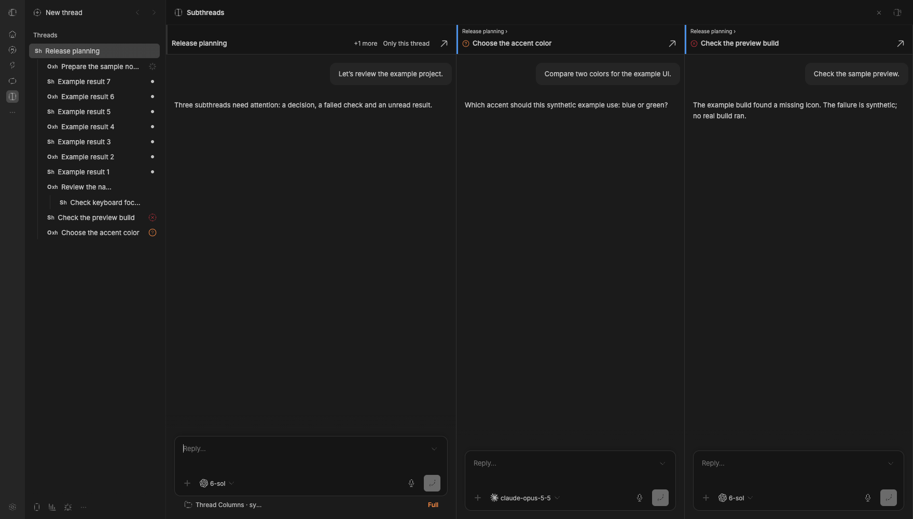

# Thread Columns

See which BB threads need you: open a parent beside its subthreads, spot failed or waiting work, and read each thread's model and effort at a glance.



*All threads and messages in the demo are synthetic examples.*

## Install

Requires BB 0.47.1 or later with its standard sidebar. The plugin uses experimental BB APIs and internal sidebar attributes; a future BB update or replacement sidebar may affect it.

```sh
bb plugin install npm:bb-plugin-model-effort-badges@0.6.0 --yes
```

The plugin's stable ID is `model-effort-badges`. Existing settings and attention records keep that identity. No external account, service or separate collector is needed. True Colors is optional: without it, badges are gray and still use outline/fill to distinguish Codex and Claude Code.

## Columns and statuses

Open a thread whose descendants need you. Its chat appears on the left, followed by eligible subthreads at any depth in tree order. A path and colored stripe show nesting. Each column has BB's own chat and composer.

- Waiting for your answer or approval takes priority, including a running agent blocked on you. Otherwise only idle failed threads and unread results get columns. Working, queued, hidden and archived threads do not.
- The default limit is eight descendant columns plus the parent. Overflow shows as **+N more**; hover for titles. Waiting threads come first, then failures, then unread results, newest first.
- **Only this thread** returns to the plain view for this tab until another descendant starts needing you. **Open** opens one column's thread normally. Automatic columns stay off on phone-width windows and when focusing an existing split pane.
- A column stays while you work in it. After its work is seen and idle it dims with a check mark; it disappears on the next opening. Off-screen chats mount as you scroll near them.
- A red cross means failure, an amber question means a pending answer or approval, and a dot means an unread result. Collapsed parents include hidden descendants' failure and unread marks. Titles starting with `○ ` are emphasized, with the prefix hidden only in the visible sidebar text.

The plugin records non-empty assistant results from newly finished runs. Older results are unknown. A descendant's result is seen after you click into its column and then leave it or the page; focus alone does not engage it. The parent is seen while open in a visible, focused window. BB's own read tracking also runs inside every embedded chat and can clear native failure/unread marks. The plugin itself never calls BB's read/unread actions.

## Badges and child threads

A badge combines the first letter of the model family with the reasoning effort, for example `Sh` for Sol / High or `Oxh` for Opus / Extra high. Hover for the full model and effort. Codex uses an outlined tile and Claude Code a filled tile; other providers retain their logo. `?` means the thread's model is unknown. Model names come from the provider catalog and reflect the next turn's execution options.

The thread actions menu adds **New child thread**. It opens BB's composer with the parent's project and environment. Sending preserves its parent, section and pin state; the selected model, effort, attachments and scheduling remain available. Close or click outside to dismiss; the draft is kept per parent. Creating and running an agent uses your existing BB provider and its normal costs.

## Settings

Open **Settings → Installed plugins → Thread Columns**.

| Setting key | Values | Default |
| --- | --- | --- |
| `placement` | `tile`, `under`, `beside` | `tile` |
| `columns` | `auto`, `off` | `auto` |
| `maxColumns` | Whole number, at least 1 | `8` |

```sh
bb plugin config model-effort-badges set columns off
bb plugin config model-effort-badges set maxColumns 6
bb plugin config model-effort-badges set placement under
bb plugin update model-effort-badges
bb plugin disable model-effort-badges
bb plugin remove model-effort-badges
```

## Data and access

This is a full-trust BB plugin. It reads thread metadata, model catalogs, execution options and the just-finished run's events. It stores result/seen timestamps in its own local SQLite database and uses BB RPC/realtime to update the interface. It does not scan earlier history, poll providers or add telemetry. Sending through a column or child composer uses BB's normal agent execution.

## Develop and release

Use Bun. The build tool is pinned to official BB 0.47.1.

```sh
bun install --frozen-lockfile
bun run check
bun test
bun run build
bun pm pack --ignore-scripts --destination /tmp
```

Inspect the tarball before release: it must include the six prebuilt `dist` files and source entries, with no maps, tests or local paths. Install and verify the exact packed bytes in a disposable BB before publishing. The npm allowlist excludes screenshots; the public repository retains the original demo above.

For a release, set the version in `package.json`, rebuild and pack, then publish that verified tarball with `npm publish /tmp/bb-plugin-model-effort-badges-VERSION.tgz --ignore-scripts`. Commit the reviewed source, create an immutable `vVERSION` tag and a GitHub Release with the tarball and SHA-256. Verify registry metadata and install `npm:bb-plugin-model-effort-badges@VERSION` in a fresh BB. Submit the same version to the BB Community marketplace with `PLUGIN_OVERVIEW.md` and the synthetic screenshot. Registry, GitHub release and catalog acceptance are separate checks.

MIT licensed.
