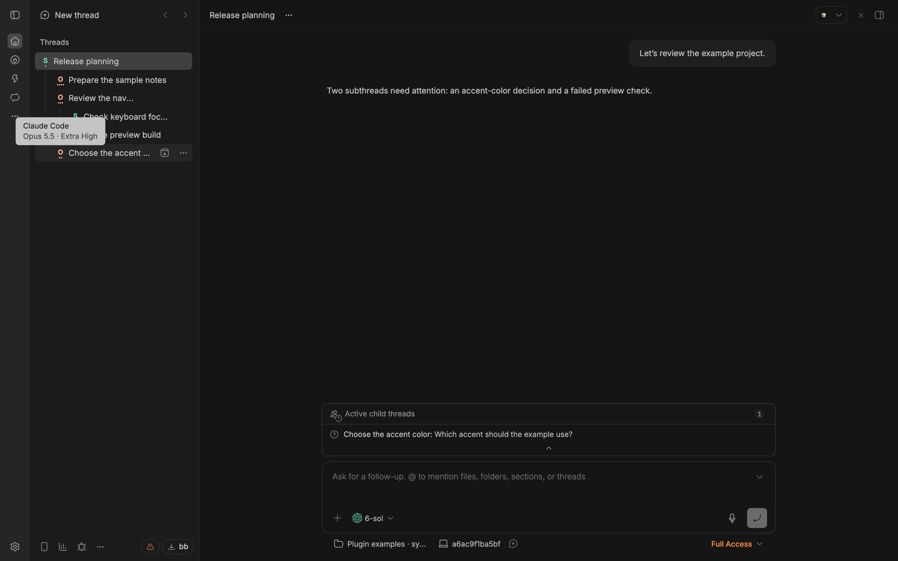

# Model & Effort Badges

See the model family and reasoning effort for each BB thread without opening its composer. A compact code sits at the provider logo; hover for the full name and effort. The badge describes the settings for the next turn. Provider color and style require the separate True Colors plugin.



*BB 0.47.1 with synthetic example data, without True Colors. Gray codes do not identify providers.*

## Install

Requires BB 0.46.1 and SDK 0.6.49 or later. The published version was tested on BB 0.47.1; no fresh BB 0.46.1 runtime test is claimed.

```sh
bb plugin install npm:bb-plugin-model-effort-badges@0.7.0 --yes
```

For a tracking source, use `bb plugin update model-effort-badges --yes`. To change a pinned version or installation source, save the plugin settings, remove its registration, install the desired version, then restore those settings individually. Removal resets settings.

To disable or uninstall, use `bb plugin disable model-effort-badges` or `bb plugin remove model-effort-badges`.

Existing users: [migration reference](MIGRATION.md).

## Try it

Compare the codes when several threads use different models or effort levels. Hover a provider logo to check the full name before sending the next turn. For long thread titles, choose **Under the logo** in the plugin settings to keep their width.

## Read the badges

```
[Ah]  BB                Ah   = GPT-6-Astra, High      (Codex; outlined with True Colors)
[Ouc] BB: model and …   Ouc  = Opus 5.5, Ultracode    (Claude; filled with True Colors)
```

- **Letter:** the model family taken from the provider catalog name, without the vendor prefix. For example, Astra, Sol and Luna for Codex; Opus, Sonnet, Haiku and Fable for Claude.
- **Effort:** `0` none, `min` minimal, `l` low, `m` medium, `h` high, `xh` extra high, `max`, `u` ultra, `uc` ultracode. Any other level shows its first two letters.
- **Color:** the tile takes its hue from True Colors (`--pbm-brand-codex`, `--pbm-brand-claude-code` and its chroma settings). Codex is outlined, Claude is filled. Without True Colors, the letters remain gray but the colored outline and fill do not render. Two providers can show the same code (for example `Sh`); use the full-name tooltip to distinguish them.
- **Hover:** hover the logo for the full model name and effort. BB's own provider tooltip gets a second line, for example `GPT-6-Astra · High`.
- **Screen readers:** the thread link reads `GPT-6-Astra, High reasoning effort` as its description.
- **Unknown:** `?` means BB has no model for the thread. The plugin never guesses one from the provider.

## Data

Each visible row reads `threads.defaultExecutionOptions`, which calls `GET /api/v1/threads/:id/default-execution-options`. This is the value the composer uses for the thread's next turn: the sticky override if set, else the last turn request, else the project default. On the server it is one indexed lookup, not a history scan.

Names come from `providers.models` once per provider. The plugin fetches a row again only when `updatedAt` or `status` changes in BB's live sidebar data. There are no timers or polling.

A message sent to a thread that is already running does not change `updatedAt`, so a model switch made that way shows once the thread goes idle.

## Setting

`Badge placement` (Settings → Installed plugins → Model & Effort Badges):

- `tile` (default): Codex and Claude Code rows show a 16px-high tile instead of the logo. The tile is as wide as its code plus padding, and the title starts 4px after it, so a longer code such as `Sxh` or `Omax` moves the title further right. The tile never reaches into the tree indent, so it cannot touch guides or chevrons. Other providers keep the logo with the caption under it.
- `under`: a 9px caption under every provider logo. Title width does not change.
- `beside`: a 10.5px chip next to every provider logo. It is easier to read but takes about three title characters.

```sh
bb plugin config model-effort-badges set placement under
bb plugin config model-effort-badges unset placement   # back to tile
```

## Compatibility

This full-trust plugin uses experimental BB APIs and internal attributes of the standard sidebar. A BB upgrade or replacement sidebar can make the badges disappear. It does not patch BB or its database.

- Internal markup it reads or decorates: `[data-sidebar-rename-row]`, `a[data-sidebar-thread-id]`, and the provider logo.
- The plugin runs as an app overlay (`experimental_appOverlay`), because it needs `useSidebarThreads`, `useSdk` and `useSettings`.
- It only adds its own element to `[data-sidebar-thread-provider]`, a line to that logo's tooltip, and an id to the row link's `aria-describedby`.
- With `tile`, its CSS hides the Codex and Claude logo inside that element and widens the element to the tile. The element keeps BB's `role="img"` label and tooltip.
- It does not touch other providers' logos, which True Colors colors, BB's spinners and activity glyphs, or BB's row actions, hover controls and keyboard behavior.
- Those `data-sidebar-*` attributes are internal BB DOM, not a public API. If BB renames them, the badges disappear and nothing else changes.

## Data and access

The plugin reads thread execution settings and provider model names through your BB server. It stores no server data and adds no telemetry. BB and your configured providers have their own data handling and telemetry settings.

## Develop

Use Bun and an installed BB CLI:

```sh
bun install --frozen-lockfile
bun run check
bun test
bun run build
```
